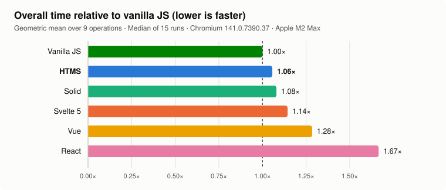
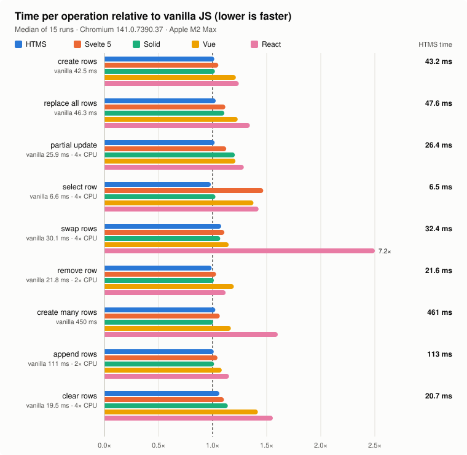
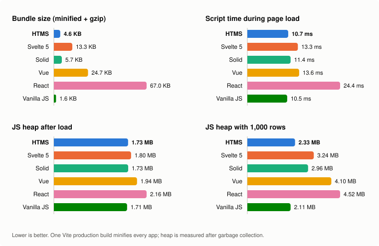

# HTMS

Write JavaScript with HTML. Yes, on purpose.

HTMS (Hyper Text Media Script) compiles HTML-flavoured source into reactive web components. The syntax borrows the good bit from ColdFusion: state, loops and events are tags too. The output is regular JavaScript built on Custom Elements, Shadow DOM and DOM events.

```html
<component name="click-counter">
  <var name="count" value="0" mutable="true"></var>

  <button on:click="count++">Clicked {count} times</button>
</component>
```

The same handler can be written as tags, which is handy when it grows:

```html
<button id="increment">Clicked {count} times</button>

<event target="#increment" type="click">
  <set name="count" op="++"></set>
</event>
```

No `eval`, no `Function` constructor and no private browser runtime to learn.

## Performance

HTMS compiles templates ahead of time into code that updates exactly the DOM nodes whose values changed, with no virtual DOM. The only runtime is a set of small helpers emitted into the compiled output. The [`bench/`](bench/README.md) suite runs the [js-framework-benchmark](https://github.com/krausest/js-framework-benchmark) operations against that project's official Svelte 5, Solid, Vue, React and vanilla JS implementations, all built by the same Vite production build and measured in Chromium from click to paint:

<!-- bench:start -->






|  | **HTMS** | Svelte 5 | Solid | Vue | React | Vanilla JS |
| :-- | --: | --: | --: | --: | --: | --: |
| **overall time vs vanilla JS** | **1.05×** | 1.14× | 1.09× | 1.23× | 1.66× | 1.00× |
| bundle size (min + gzip) | **4.2 KB** | 13.3 KB | 5.7 KB | 24.7 KB | 67.0 KB | 1.6 KB |
| script time during page load | **10.4 ms** | 12.9 ms | 11.0 ms | 13.3 ms | 23.8 ms | 9.9 ms |
| JS heap after load | **1.71 MB** | 1.80 MB | 1.73 MB | 1.94 MB | 2.17 MB | 1.70 MB |
| JS heap with 1,000 rows | **2.32 MB** | 3.24 MB | 2.96 MB | 4.10 MB | 4.52 MB | 2.11 MB |
| create rows | **30.9 ms** | 31.7 ms | 31.6 ms | 35.0 ms | 37.2 ms | 29.6 ms |
| replace all rows | **33.4 ms** | 36.4 ms | 35.7 ms | 41.0 ms | 43.0 ms | 32.4 ms |
| partial update (4× CPU slowdown) | **14.5 ms** | 15.6 ms | 16.5 ms | 17.2 ms | 18.1 ms | 13.3 ms |
| select row (4× CPU slowdown) | **3.7 ms** | 5.8 ms | 4.1 ms | 4.7 ms | 5.2 ms | 3.5 ms |
| swap rows (4× CPU slowdown) | 19.8 ms | **18.5 ms** | 19.0 ms | 19.9 ms | 143 ms | 17.5 ms |
| remove row (2× CPU slowdown) | **15.3 ms** | **15.3 ms** | **15.3 ms** | 18.0 ms | 17.4 ms | 15.0 ms |
| create many rows | 443 ms | 463 ms | **433 ms** | 505 ms | 687 ms | 425 ms |
| append rows (2× CPU slowdown) | **108 ms** | 109 ms | 111 ms | 118 ms | 122 ms | 107 ms |
| clear rows (4× CPU slowdown) | **20.2 ms** | 21.0 ms | 20.6 ms | 26.9 ms | 31.0 ms | 18.8 ms |

HTMS has the lowest overall time of the frameworks tested (1.05× vanilla JS), and it spends the least time in JavaScript of any framework on 9 of 9 operations ([scripting table](bench/results/RESULTS.md#scripting-time-ms-median)). Rows where HTMS matches or beats each framework: Svelte 5 13 of 14, Solid 12 of 14, Vue 14 of 14, React 14 of 14.
Bold marks the best framework in each row; vanilla JS is the hand-written reference. Chromium 141.0.7390.37 on Apple M2 Max,
median of 15 runs, measured 2026-10-14. Full tables are in
[bench/results/RESULTS.md](bench/results/RESULTS.md); the method and caveats are in
[bench/README.md](bench/README.md).
<!-- bench:end -->

## Try it from this repo

The current toolchain requires Node 20.19 or newer.

```bash
npm ci
npm run build
npm run htms -- create click-counter
npm run htms -- dev click-counter.html
```

Open `http://127.0.0.1:5173/`, click the button, then edit the HTML. The browser reloads after a clean compile. If you misspell a tag or forget an attribute, the error appears in the preview and the terminal with the source line and a suggested fix.

The starter is deliberately small enough to pull apart. HTMS won't replace an existing file unless you pass `--force`.

[Try the live component demos](https://vheissu.github.io/htms/), read the
[getting-started guide](https://github.com/Vheissu/htms/blob/master/docs/getting-started.md),
or run `npm run demo:serve` and open `http://localhost:5173/demos/`.

## CLI

- `htms create <name>` makes an interactive starter. `htms new` is an alias.
- `htms dev <file>` compiles, serves a preview and reloads it on save.
- `htms validate <file>` runs the real compiler without writing output.
- `htms compile <file>` writes JavaScript and a sibling TypeScript declaration.
- `htms watch <file>` recompiles without starting a server.
- `htms render <file>` produces server-rendered Declarative Shadow DOM.

Run `htms <command> --help` for every option. If a file declares several components, pass `--tag <name>` to `dev` or `render`. `compile`, `watch` and `dev` accept `--renderer legacy` to use the reconciling renderer instead of fine-grained blocks.

## Expressions

Attributes such as `condition`, `expr`, `when` and `on:click`, plus `{...}` in markup, are JavaScript expressions evaluated against the component. Name a prop, `<var>`, `<derive>` or `<function>` directly; the compiler turns `count` into `this.count`. Loop variables, `event`, locals you declare and globals (`Math`, `Date`, `JSON`) keep their usual meaning, and writing `this.count` still works.

```html
<var name="items" value='[{"name": "Tea", "price": 3.5}]'></var>
<var name="rate" value="1.1"></var>

<p>{items.length} items, total {items.reduce((sum, item) => sum + item.price, 0) * rate}</p>
<p if="items.length === 0">Nothing here yet.</p>
```

- `{user.name}` is null-safe: it renders nothing while `user` is still loading, rather than failing the render.
- Braces only interpolate when the expression reads a component field, a loop variable or `this`. CSS blocks and literal text such as `{ braces }` are left alone.
- `value="..."` on `<var>`, `<set>` and `<push>` is a literal: `'text'`, `42`, `true`, `null`, JSON, or the name of a field. Any other bare word is a string, so `value="done"` sets `"done"`. Use `expr="..."` for anything computed.

## Inline bindings

Markup elements accept directive attributes. They compile to the same listeners and properties as the directive tags and survive re-renders the same way.

| Attribute | Effect |
| --- | --- |
| `on:click="count++"` or `@click="..."` | Runs statements on the event. `event` is available. The component re-renders afterwards, so `items.push(x)` shows up. |
| `on:submit.prevent`, `.stop`, `.once`, `.passive`, `.capture`, `.self` | Event modifiers. |
| `on:keydown.enter`, `.esc`, `.space`, `.tab`, `.up`/`.down`/`.left`/`.right` | Key filters for keyboard events. |
| `on:input.debounce-250` | Debounces the handler (`.debounce` alone means 300 ms). |
| `bind:value="name"` | Two-way binding. Also `bind:checked`, `bind:valueasnumber`, `bind:selectedindex` and `bind:open`. Number and range inputs store numbers. |
| `class:done="todo.done"` | Adds the class while the expression is truthy. |
| `style:width="pct + '%'"` | Sets an inline style property; `null` or `false` removes it. |
| `if="error"` | Renders the element only while the expression is truthy. |

```html
<component name="todo-list">
  <var name="todos" value="[]" mutable="true"></var>
  <var name="draft" value="''" mutable="true"></var>

  <form on:submit.prevent="todos.push({ text: draft, done: false }); draft = ''">
    <input bind:value="draft" placeholder="Add a task">
  </form>

  <ul>
    <repeat variable="todos" item="todo" index="i">
      <li class:done="todo.done">
        <input type="checkbox" bind:checked="todo.done"> {todo.text}
        <button on:click="todos.splice(i, 1)">Remove</button>
      </li>
    </repeat>
  </ul>
</component>
```

HTML lowercases attribute names, so custom events used with `on:` should be kebab-case (`on:item-selected`). Native `onclick` attributes remain blocked; the browser would run them outside HTMS.

## Methods

`<function>` inside a component becomes a method. The body can mix JavaScript and HTMS tags, `params` become arguments, and the component re-renders when the method returns.

```html
<function name="add" params="text">
  if (!text.trim()) return;
  todos.push({ id: Date.now(), text: text.trim(), done: false });
</function>

<button on:click="add(draft)">Add</button>
<p>{format(total)}</p>
```

Use `async="true"` for methods that `await`. Every component also has `$(selector)` and `$$(selector)` to query its own render root, plus `emit(name, detail)` to dispatch a composed `CustomEvent`.

## Component Inputs

`<component>` can expose browser-native custom element inputs:

```html
<component
  name="user-badge"
  props="labelText, count:number, active:boolean, options:json"
>
  <span id="label"></span>
  <bind selector="#label" prop="textContent" expr="this.labelText"></bind>
</component>
```

- `props` creates public properties with reactive setters. A prop is a string unless its name ends with `:number`, `:boolean`, or `:json`.
- Props initialize from their matching kebab-case attributes (`labelText` reads `label-text`) and default to `null` when no attribute is present.
- Declared props automatically observe their matching attributes. Boolean props use attribute presence, invalid numbers and JSON become `null`, and a missing boolean attribute becomes `false`.
- `observed` can list extra attributes that aren't declared as props. Those are exposed as camel-cased string properties.

## Output formats

`--format esm` exports all generated classes in one ESM export list. `--format cjs` writes them to `module.exports`. `--format iife` registers the elements immediately and exposes the classes on `globalThis.HTMSComponents`.

Every format also gets a `.d.ts` file describing component props, emitted events, update lifecycle, and `HTMLElementTagNameMap` entries.

## Component updates

Prop changes and top-level state changes are batched into one render per microtask. An event handler can update several fields without rebuilding the component after every write.

Every generated component has `requestUpdate()` and `updateComplete`:

```js
counter.count = 2;
counter.count = 3;
await counter.updateComplete;
```

The DOM now contains the state for `3`, after one render. Assigning a new value to a field declared with `<var>` schedules an update. JavaScript can't observe an in-place nested mutation such as `counter.items.push(value)`, so call `counter.requestUpdate()` after that kind of change. HTMS `<push>` and `<splice>` do this automatically.

The compiler turns markup into blocks: a static template cloned once per instance, references to the nodes that can change, and an update method that re-evaluates each `{expression}` and binding and writes to the DOM only when its value changed. An update never rebuilds or diffs markup, so nodes keep their identity, keyboard focus, text selection, scroll position, and unfinished values in uncontrolled form fields. Fields managed by `bind:value`, `<bind>`, `<model>`, or `<setprop>` use their component state as the source of truth.

Lists reuse rows by position, or by identity when the loop has a `key`:

```html
<repeat variable="todos" item="todo" key="todo.id">
  <li class:done="todo.done">{todo.text}</li>
</repeat>
```

Keyed rows are matched by key and moved with as few DOM moves as possible (a longest-increasing-subsequence pass), so reordering, inserting and removing rows never recreates the rows that stay. A row that still holds the same item object keeps its place without evaluating the key, and a render that changed no order allocates nothing for the list. Event handlers in a component share one listener per event type on the component root.

A component that needs a feature the block renderer does not handle (`<while>`, or a directive selector that could match markup a loop creates) is compiled with the previous renderer, which builds a fragment on each render and reconciles it with the DOM. Pass `renderer: 'legacy'` to `parseHTML` to choose that renderer explicitly.

If a render fails, the component stores the error in `renderError` and emits a bubbling, composed `htms-error` event. Call `event.preventDefault()` after handling the error to suppress the default console report.

## Server rendering and hydration

The server API renders compiled components in an isolated JSDOM document and returns Declarative Shadow DOM plus a JSON hydration manifest:

```ts
import { renderToString } from 'htms';

const { html } = renderToString(source, {
  tagName: 'user-badge',
  props: { labelText: 'Ready', count: 2 },
});
```

The CLI exposes the same path:

```bash
htms render component.html \
  --props '{"labelText":"Ready","count":2}' \
  --attributes '{"class":"compact"}' \
  --output component.ssr.html
```

`<effect>` and `<fetch>` stay dormant on the server. In the browser, load the compiled component bundle and call `hydrate()` from the package. The first client render adopts the server tree in place, including a fallback for parsers that leave Declarative Shadow DOM as a template. Loop and branch content is marked with `<!--[-->` and `<!--]-->` comments in the server output and re-created on hydration; the surrounding markup keeps its server-rendered nodes.

## How It Works (roughly)

- Parses HTMS markup with parse5 into a light source tree, converts nodes to directives via tag handlers, resolves component fields in expressions, validates the output with Acorn, then emits JavaScript through Escodegen.
- A security pass rejects dangerous constructs (`eval`, inline handlers, raw `innerHTML`, path traversal, …).
- In component mode, standard elements become cached `<template>` fragments that each instance clones. Control and state tags compile into block methods that update only the nodes whose values changed.
- Directive selectors such as `<event target="#save">` and `<bind selector="#count">` are resolved at compile time against the template, so they cost nothing at runtime.
- Directives work inside tables: `<tbody><repeat ...><tr>…</tr></repeat></tbody>` keeps the rows where they are written instead of letting the HTML parser move them out of the table.
- Component text and attributes can interpolate reactive state and props with `{count}`, `{user.name}`, and `{labelText}`.
- Components compose through normal custom elements and browser slots. Dynamic SVG and MathML nodes keep their namespaces.
- Component-owned runtime effects are disposed in `disconnectedCallback`, so cleanup handlers and fetch aborts run when elements leave the page.
- Effect and fetch helpers share one runtime bootstrap per generated bundle. Components that do not use runtime-backed directives do not include it.
- Server and client rendering use the same component compiler and generated code.

## Tag glossary

- State & Arrays
  - `<var name="x" value="42" mutable="true" />` — declare component state (accepts quoted strings, numbers, booleans and JSON, including arrays of objects).
  - `<object name="user">…<property name="name" value="Ada" /></object>` and `<array name="tags"><value>a</value></array>` — declare object/array state from child tags.
  - `<derive name="total" expr="this.items.length" />` — compute reactive state before each render.
  - `<set name="x" op="=|+=|-=|*=|/=|++|--" value="…" />` or `expr="…"` — mutate values; notifies bindings. `+=` concatenates strings.
  - `<push array="state.list" expr="document.getElementById('txt').value" />` — push; notifies bindings.
  - `<splice array="state.list" index="0" delete="1" values='["New"]' />` — remove/insert; notifies bindings.
- Control Flow
  - `<repeat variable="items" item="it" index="i">…</repeat>` or `<repeat count="3" index="n">…</repeat>` (`count` may be an expression such as `count="rating"`) — `item` names the loop variable (default `item`); inside, use `{it}`, property paths like `{it.name}`, and the optional index token (`{i}` here) in text or attribute values. Add `key="it.id"` to keep each row's DOM nodes when the array is reordered.
  - `<if condition="flag">…</if><else-if condition="other">…</else-if><else>…</else>` — nested tags allowed.
  - `<while condition="state.count < 3" max="1000">…</while>` — guarded loop; `max` prevents infinite loops.
  - `<switch variable="day">…</switch>` or `<switch expr="this.day">…</switch>` — nested tags allowed.
- DOM Updates
  - `<setprop selector="#msg" prop="textContent" expr="'Hello'" />` — set property (use `expr` for JS, or `value` for literals).
  - `<setattr selector="#link" name="title" value="Info" />` — set attribute. `expr="…"` computes it; `null`/`false` removes it.
  - `<append target="#list"> <li>Row</li> </append>` — append generated children to an existing element.
  - `<class selector="#card" name="active" when="this.isActive" />` — toggle class based on expression.
  - `<style selector="#card" prop="background-color" value="red" />` — set inline style.
  - `<model selector="#name" path="name" />` — two-way input binding (`value` + `input` event). Add `number="true"` to store numbers. `bind:value` on the input is the inline equivalent.
- Visibility
  - `<toggle target="#panel" condition="isOpen" />` — show/hide (style.display).
  - `<show target="#a" when="x > 5" />` — sugar over TOGGLE.
- Reactive Bindings
  - `<bind selector="#cnt" prop="textContent" expr="String(state.items.length)" />` — binds DOM to an expression; updates on SET/PUSH/SPLICE.
  - Native component markup can also bind directly: `<p title="Count {count}">{label}: {count}</p>`.
  - Interpolating a boolean attribute (`disabled`, `checked`, `readonly`, …) toggles the attribute's presence instead of rendering `"true"`/`"false"` strings: `<button disabled="{submitting}">`.
  - HTMS directives nest inside ordinary markup, scoped to the enclosing element: `<div><event target="#btn" type="click">…</event></div>` works without a top-level `<event>`.
- Lists (keyed)
  - `<keyedlist target="#ul" of="items" item="it" index="i" key="it.id"> <li>{it.name}</li> </keyedlist>` — component-scoped keyed list rendering with item/index interpolation and DOM node preservation for matching keys.
- Composition
  - Put one compiled custom element inside another as normal HTML. The compiler keeps custom-element children instead of treating them as unknown HTMS tags.
  - Use `<slot></slot>` and `<slot name="heading"></slot>` inside a component to accept default and named content from its parent.
  - SVG and MathML can sit directly in a component template, including interpolated attributes.
- Events
  - `<event target="#btn" type="click"> …child tags… </event>` — handler is composed of child tags (no action string required). `type` accepts any DOM event name, including custom events dispatched by `<emit>`. `target="window"`, `"document"` or `":host"` listen outside the render root and detach with the component.
  - Event modifiers: `prevent="true"` calls `event.preventDefault()`, `stop="true"` calls `event.stopPropagation()`, `self="true"` ignores events from descendants, `once="true"` removes the listener after the first fire (it stays fired across re-renders), `passive="false"` marks the listener non-passive, `key="Enter"` filters `KeyboardEvent`s, and `debounce="200"` delays the handler by N milliseconds. `<event>` tags can nest inside ordinary markup — they bind relative to the enclosing element.
  - `<submit target="#form"> …child tags… </submit>` — form submit helper (prevents default). Use child tags to update state/DOM.
  - `<emit name="count-changed" detail="this.count" />` — dispatches a `CustomEvent` from the component so parents can react. Place it inside an `<event>`/`<submit>` handler. Defaults to `bubbles`/`composed` so the event crosses the shadow boundary; opt out with `bubbles="false"` / `composed="false"`, or set `cancelable="true"`.

## Component Demos

- `demos/hello-world-component.html` — minimal “hello” rendered via shadow DOM.
- `demos/event-toggle-component.html` — `<event>`, `<setattr>`, and `<toggle>` working together.
- `demos/bind-component.html` — `<bind>` hydrates text content without global state.
- `demos/counter-component.html` — `<var>`, `<set>`, and `<bind>` demonstrate reactive state and re-rendering.
- `demos/derived-component.html` — derived values update before template interpolation and bindings.
- `demos/emit-component.html` — `<emit>` dispatches a composed `CustomEvent` to the host so parents can listen.
- `demos/composition-component.html` — two compiled components composed with named and default slots.
- `demos/ssr-card-component.html` — typed props rendered on the server and updated through a client event.
- `demos/list-component.html` and `demos/todo-component.html` — repeat rendering, keyed updates, item events, and form state.
- `demos/effect-fetch-component.html`, `demos/effect-fetch-error-component.html`, and `demos/effect-fetch-auto-component.html` — request success, failure, cleanup, and automatic loading.

## Security boundary

HTMS rejects known executable sinks and unsafe template attributes, but source files are still application code. Do not compile untrusted markup and execute the result.

- `<inject>` is disabled entirely unless `HTMS_ALLOW_INJECT_TAG=true` is set — and even then it writes through `textContent`, never `innerHTML`.
- Inline event-handler attributes (`onclick`, `onload`, …) are rejected in markup; use `on:click` or `<event>` instead.
- Dynamic URL attributes (`href="{link}"`, `<setattr name="src" expr="…">`) are checked when they render. `javascript:`, `vbscript:` and `data:text/html` values become `about:blank`.
- File logging is opt-in: set `HTMS_LOG_DIR` to write `htms-combined.log`/`htms-error.log` to a chosen directory. Importing the library never writes files to your working directory.
